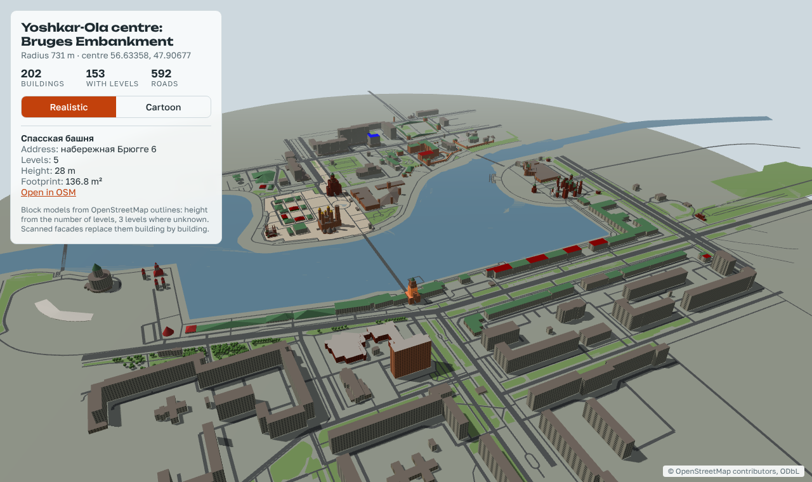
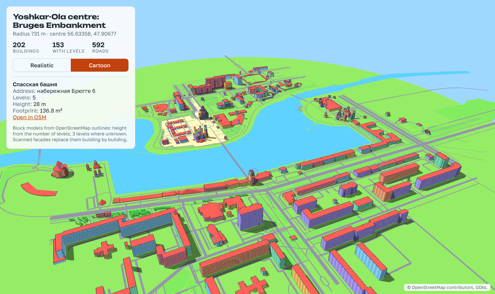
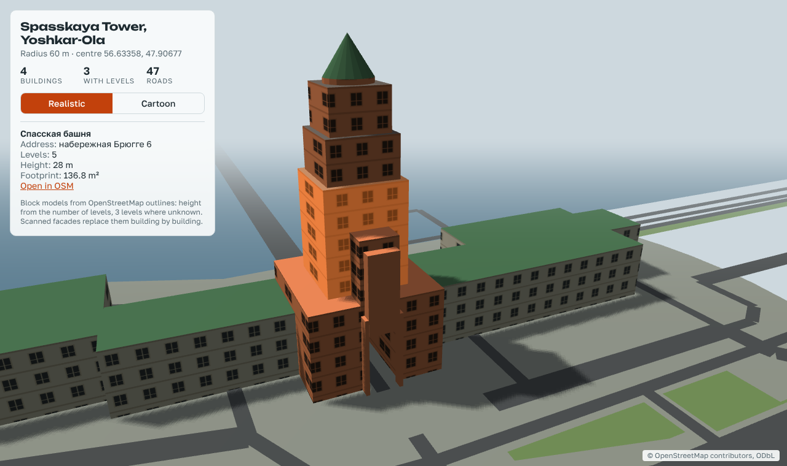
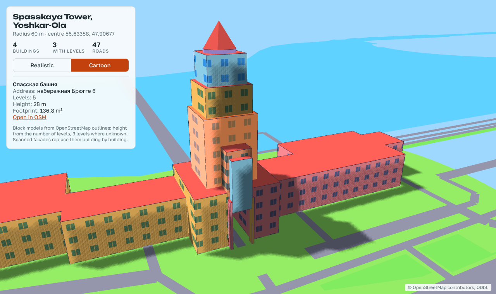
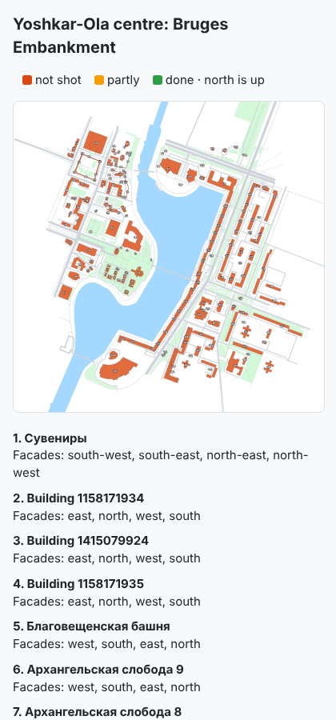

# city3d: a real city in 3D

**English** · [Русский](README.ru.md)

A Claude Code skill that builds a real city in 3D: a universal, realistic
map that other projects are built on. Every building is a separate model
standing on its own footprint and knows its name and address; the
landscape is shared and grows tile by tile as the map gets bigger.

On top of one map you can make many things:
- games (Unreal, Godot, Unity);
- films and animation (USD for Blender, Houdini, Omniverse, Unreal);
- a guided walk or virtual tour of famous places (in the browser or VR);
- restyled versions of the city: cartoon, low-poly, winter, historical.

The map itself stays realistic and accurate; styles and projects are made
from it, not in it.

The base comes from open OpenStreetMap data. The quality comes from your own
photos and video: the agent builds everything it can, then tells you which
buildings to shoot and from which sides.




## How it works

```
place + radius → OpenStreetMap → block model of every building → shot list
       ↑                                                            ↓
rebuild with scans  ←  models from your frames  ←  you shoot what is listed
```

1. You name a place and a radius, for example "the puppet theatre in
   Yoshkar-Ola, 300 m".
2. The agent downloads OSM and builds every building from its outline and
   number of storeys, plus one landscape: roads, lawns, water and trees.
3. The agent looks through the photos and video you already have and notes
   what is usable.
4. You get a **shot list**: a phone-friendly map, buildings in walking order
   and the facades still needed for each. Every building gets its own folder
   with a `TO_SHOOT.md` file. You drop new photos into that building's
   `photos/` folder and tell the agent "added".
5. Building models are made from the new frames (COLMAP + OpenMVS, or
   RealityScan), placed on their footprints, and the loop repeats until you
   are happy with the result.
6. Export to Blender (`.blend`) and `.glb` for Unreal, Godot and Unity.

### Working as a team

Each building folder is self-contained: hand it to a helper, they shoot the
building, build a model in any tool, align it to the `block.obj` in the
folder and put a `.glb` into `model/`. When the folders come back, one
command puts every finished building on the map in place of its block:

```
blender -b -P blender_city.py -- city/city.json --scans buildings/ --out build/
```

| Close-up: Spasskaya Tower, realistic | The same, cartoon |
|---|---|
|  |  |

The browser preview opens with a double click. Click a building to see its
card: name, address, storeys, height, a link to OpenStreetMap and, once the
folders exist, a link to the building's own photo folder.



## Install

In Claude Code:

```
/plugin marketplace add ildargiv/city3d-skill
/plugin install city3d@city3d
```

Then just say: "Build the district around ... in 3D, radius 300 m".

You will need:
- Python 3.9+
- Blender 4.2+ for the scene and export ([BlenderMCP](https://github.com/ahujasid/blender-mcp) is optional)
- ffmpeg for video
- COLMAP and OpenMVS to build models from frames. Both run without an NVIDIA
  card, only slower. With an NVIDIA card, RealityScan gives better results.
  Download and unpack them yourself, no installation needed:
  [COLMAP](https://github.com/colmap/colmap/releases) (`colmap-x64-windows-nocuda.zip`)
  into `Programs\colmap` and
  [OpenMVS](https://github.com/cdcseacave/openMVS/releases) (`OpenMVS_Windows_x64.zip`)
  into `Programs\openmvs`. Claude Code's safety checks usually do not let
  the agent download and run third-party programs by itself.

The interface follows the browser's language. Pass `--lang ru` to
`osm2city.py`, `shotlist.py` and `house_folders.py` for Russian labels and
folder names; an existing project keeps the language it was created in.

## Keeping it cheap: which model does what

The heavy work (map, Blender, video, 3D reconstruction) is done by programs
on the CPU and costs no tokens. Models are only needed for decisions:

- **Opus**: developing the skill and unclear cases.
- **Sonnet**: the routine loop (`/model sonnet`), plus the helper agents
  `building-matcher` (which building is in the frame) and `model-builder`
  (building one model).
- **Haiku**: the `frame-triage` helper: new files, cutting frames, dropping
  blurry ones.

Start each new round in a fresh session: all the state lives in the folders
and `STATUS.md`.

## What data you may use

In short: OpenStreetMap, open elevation data, Mapillary/Panoramax and your
own photos and video. Maps, panoramas and 3D models from Google, Yandex and
2GIS are for looking at only; copying them into a model is not allowed, even
for personal use. Details and links to each service's terms:
[references/legal.md](skills/city-3d/references/legal.md). If you bring
other sources, that is your own responsibility.

Every export carries the credit "© OpenStreetMap contributors (ODbL)".

## Example

[examples/yoshkar-ola](examples/yoshkar-ola): the centre of Yoshkar-Ola,
Russia, from the puppet theatre to the Spasskaya and Blagoveshchenskaya
towers, including the Bruges Embankment. 202 buildings and 229 building
parts with a ready shot list. Open `index.html` with a double click.
Building names come from OSM and stay in Russian.

## Scripts

| Script | What it does |
|---|---|
| `fetch_osm.py` | downloads OSM around a point and radius (Overpass) |
| `osm2city.py` | turns OSM into `buildings.csv`, `city.json`, `city.obj` and the `index.html` preview |
| `preview.html` | 3D browser preview: realistic and cartoon looks, windows, roofs, a card per building with a link to its folder |
| `blender_city.py` | Blender scene: each building a separate object, one landscape, `.glb` export |
| `shotlist.py` | shot list: what to shoot and in what order |
| `house_folders.py` | a folder per building (`photos`, `frames`, `model`, `TO_SHOOT.md`) and a check for newly added photos |
| `extract_frames.py` | cuts video into sharp frames |
| `photogrammetry.py` | builds a building model from frames (COLMAP + OpenMVS) |
| `doctor.py` | checks the machine for every tool the skill uses, with download links |
| `qa.py` | checks finished building models against the budgets in `targets.json` |
| `odm_split.py` | cuts a drone model from OpenDroneMap/WebODM into one model per building |

## Tests

Offline tests on a tiny hand-made district (no network, no Blender needed;
the Blender part runs when `pip install bpy` is present):

```
python3 -m unittest discover -s tests
```

`evals/trigger_evals.json` lists requests that should and should not start
the skill. They run on every push (GitHub Actions).

## Licence

The code is MIT. The map data in the example and in every export is
© OpenStreetMap contributors, ODbL.
